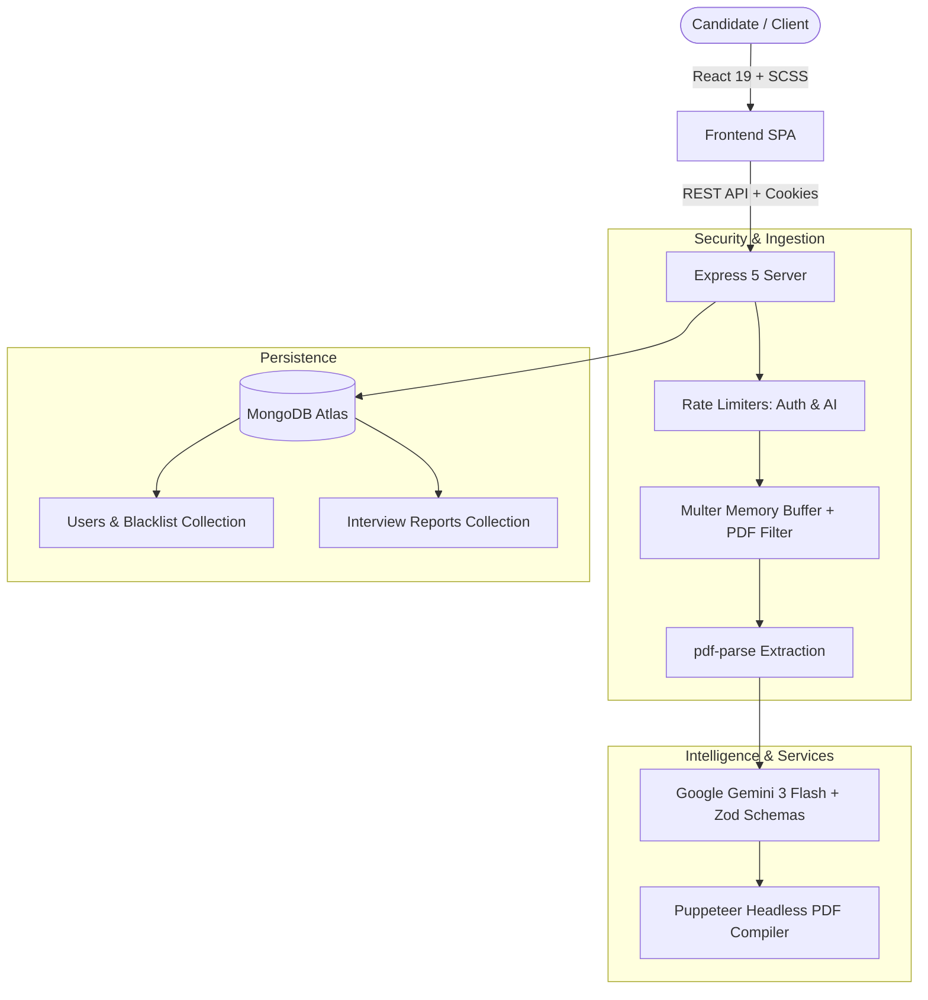

# TalkTheTalk 🎙️ — AI Technical Interview & Career Coach

An end-to-end, AI-powered interview preparation and career coaching platform. **TalkTheTalk** analyzes a candidate's resume PDF, personal pitch, and target job description to formulate custom interview strategies, identify skill gaps, evaluate practice answers via speech or text in real time, and compile downloadable ATS-friendly resumes.

---

## 🌟 Key Features

### 1. 🤖 Deterministic AI Interview Plan Generation
- **Schema-Enforced LLM Responses**: Utilizes **Google Gemini 3 Flash** constrained with **Zod Schemas** via `zod-to-json-schema`. Ensures 100% structured JSON responses without hallucinations or broken formats.
- **Role Match Score**: Evaluates candidate experience against job requirements and scores relevance from 0 to 100%.
- **Skill Gap Analysis**: Identifies missing or weak technical competencies categorized by severity (`low`, `medium`, `high`).
- **Targeted Question Bank**: Generates role-specific **Technical** and **Behavioral** questions, each complete with the interviewer's intention and model answer rubrics.
- **Day-by-Day Preparation Roadmap**: Formulates a structured study timeline broken down into daily focuses and actionable tasks.

### 2. 🎯 Interactive Mock Interviewer ("Practice & Feedback Mode")
- **Voice or Text Response**: Candidates can type their answer or dictate in real time using the browser's native **Web Speech API** (zero external paid audio APIs required).
- **AI Rubric Scoring**: Submits the user's answer alongside the model answer to Gemini for an objective assessment.
- **Instant Structured Critique**:
  - **Numerical Score**: 1 to 10 rating.
  - **Strengths**: Highlights concepts answered accurately.
  - **Improvement Areas**: Pinpoints missed architectural points or incorrect statements.
  - **Constructive Summary**: Concrete advice to refine the response.

### 3. 📄 Automated ATS Resume Generator & PDF Export
- Generates a tailored, ATS-friendly resume directly aligned with the target job requirements.
- Uses headless **Puppeteer** to compile clean, semantic HTML into a styled **A4 PDF document**.
- Direct one-click download stream from the frontend dashboard with an isolated loading spinner.

### 4. 🛡️ Robust Security & Production Hardening
- **Strict File Ingestion**: In-memory buffer parsing via **Multer** and `pdf-parse`, enforcing `.pdf` MIME validation and a strict **5MB** size cap to protect memory.
- **Tiered Rate Limiting (`express-rate-limit`)**:
  - `authLimiter`: Max 20 requests per 15 minutes to prevent brute-force attacks.
  - `aiLimiter`: Max 15 generation/evaluation calls per hour per IP to protect Gemini API quotas and prevent DDoS.
- **Stateless Auth with Stateful Invalidation**: JWT cookies with HTTP-only flags combined with a **MongoDB Token Blacklist** (TTL-indexed) for immediate logout invalidation.
- **Error Handling Middleware**: Global exception catches preventing server crashes or stack trace leakage on corrupted files.

---

## 🏗️ Architecture & Tech Stack



| Layer | Technologies |
| :--- | :--- |
| **Frontend** | React 19, Vite, React Router 7, SCSS, Axios, Web Speech API |
| **Backend** | Node.js, Express 5, Multer, `pdf-parse`, `express-rate-limit`, Puppeteer |
| **AI & Schema** | Google Gen AI SDK (`@google/genai`), Google Gemini 3 Flash, Zod, `zod-to-json-schema` |
| **Database** | MongoDB & Mongoose (Atlas), JWT, bcryptjs |

---

## 🚀 Getting Started

### Prerequisites
- [Node.js](https://nodejs.org/) (v18 or higher recommended)
- [MongoDB Atlas](https://www.mongodb.com/cloud/atlas) or a local MongoDB instance
- [Google Gemini API Key](https://aistudio.google.com/app/apikey)

---

### 1. Environment Setup

Create a `.env` file inside the `Backend/` directory:

```env
PORT=3000
MONGO_URI=mongodb+srv://<username>:<password>@cluster0.xxxx.mongodb.net/talkthetalk?retryWrites=true&w=majority
JWT_SECRET=your_super_secret_jwt_key
GOOGLE_GENAI_API_KEY=your_gemini_api_key_here
```

---

### 2. Installation & Running

#### Start the Backend:
```bash
cd Backend
npm install
npm run dev
```
*Server runs on `http://localhost:3000` with nodemon.*

#### Start the Frontend:
```bash
cd Frontend
npm install
npm run dev
```
*Frontend runs on `http://localhost:5173`.*

---

## 📡 API Overview

| Method | Endpoint | Description | Access |
| :--- | :--- | :--- | :--- |
| `POST` | `/api/auth/register` | Register a new user | Public (Rate-limited) |
| `POST` | `/api/auth/login` | Log in and receive JWT cookie | Public (Rate-limited) |
| `GET` | `/api/auth/logout` | Invalidate JWT and add to blacklist | Public |
| `GET` | `/api/auth/get-me` | Get current authenticated user profile | Private |
| `POST` | `/api/interview/` | Generate interview report from resume PDF & job description | Private (Rate-limited) |
| `GET` | `/api/interview/` | Fetch recent interview reports of logged-in user | Private |
| `GET` | `/api/interview/report/:id` | Fetch detailed report by ID | Private |
| `POST` | `/api/interview/resume/pdf/:id` | Compile and stream tailored ATS Resume PDF | Private (Rate-limited) |
| `POST` | `/api/interview/evaluate` | Evaluate candidate practice answer against question rubric | Private (Rate-limited) |

---

## 📄 License
This project is licensed under the ISC License.

